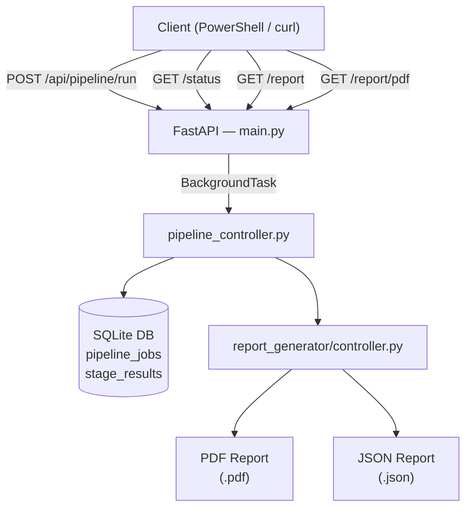
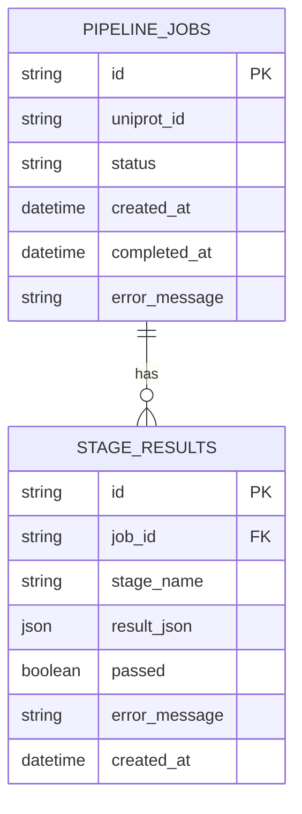

# MEV Pipeline — Architecture & Documentation

## Overview

The **Multi-Epitope Vaccine (MEV) Pipeline** is a backend system that automates the computational design of synthetic multi-epitope vaccines from a single protein target. It implements 12 sequential bioinformatics steps — from sequence retrieval to in-silico cloning — each as an independent service module that exchanges structured JSON data.


## System Architecture

### High-Level Flow



### Detailed 12-Step Pipeline

```mermaid
flowchart LR
    S1["Step 1\nUniProt\nFetch"] --> S2

    S2{"Step 2\nAntigenicity\nGATE"}
    S2 -->|score < 0.4\nHARD STOP| FAIL["Job: failed\nPipeline terminates"]
    S2 -->|score >= 0.4| S3

    S3["Step 3\nPhysicochemical\nProtParam"] --> S4

    S4["Step 4\nEpitope Prediction\n4A B-cell\n4B MHC-I 9-mer\n4C MHC-II 15-mer"] --> S5

    S5["Step 5\nPopulation\nCoverage"] --> S6

    S6["Step 6\nSafety Filtering\nToxinPred + AllerTOP\n+ VaxiJen per epitope"] --> S7

    S7["Step 7\nIFN-Gamma\nPrediction"] --> S8

    S8["Step 8\nMolecular Docking\nHDOCK\nEpitope x HLA"] --> S9

    S9["Step 9\nModel Evaluation\nH-bonds, contacts\nsteric clashes"] --> S10

    S10["Step 10\nConstruct Design\nRS09+EAAAK+epitopes\n+PADRE+HP91"] --> S11

    S11["Step 11\nCodon Optimization\nJCat"] --> S12

    S12["Step 12\nIn-Silico Cloning\npShuttle-CMV\nSnapGene"] --> DONE["Completed\nPDF + JSON"]
```



### Data layer




## File-by-File Reference

### `backend/main.py`

**Role**: FastAPI application entry point.

**Biological context**: Acts as the interface between the researcher and the pipeline. A scientist submits a UniProt ID (the target antigen's accession number) and receives a job receipt. They then poll for results and download the vaccine design report — mimicking wet-lab protocol automation.

**Key endpoints**:

| Method | Path | Description |
|--------|------|-------------|
| `POST` | `/api/pipeline/run` | Submit a UniProt ID → returns `job_id` |
| `GET` | `/api/pipeline/{id}/status` | Poll: `pending / running / completed / failed` |
| `GET` | `/api/pipeline/{id}/report` | Full structured JSON report |
| `GET` | `/api/pipeline/{id}/report/pdf` | Downloadable PDF report |
| `GET` | `/api/health` | Server health check |

**Design decisions**:
- Uses `BackgroundTasks` so the API returns immediately without blocking
- Each pipeline run gets a UUID as job ID for independent tracking
- Multiple proteins can be evaluated in parallel

---

### `backend/pipeline_controller.py`

**Role**: Orchestrates the 12-step MEV pipeline sequentially.

**Biological context**: Mirrors a computational vaccine design lab workflow — each stage builds on the previous one, just as a wet-lab scientist would: screen antigen → map epitopes → validate safety → design construct → optimize for expression.

**Key behaviors**:
- **Hard gate at Step 2**: if `AntigenicityGateError` is raised, marks job `failed` and returns immediately — downstream stages are never executed
- Each step saves its result to the database before proceeding to the next
- Passes specific outputs between steps (e.g., safe epitope lists from Step 6 → Step 7/8/10)

---

### `backend/database/__init__.py` + `models.py` + `base.py`

**Role**: SQLite database configuration and ORM models.

**Tables**:
- `pipeline_jobs` — tracks status of each protein evaluation run
- `stage_results` — stores the JSON output of every executed stage

**Biological context**: Provides audit trail and reproducibility — a core requirement in computational biology. Every intermediate result is persisted so researchers can review exactly what was predicted at each stage.

---

## Service Modules

### `services/sequence_service.py` — Step 1: Sequence Retrieval

**Tool**: UniProt REST API

**Biological context**: UniProt is the world's leading protein knowledge base. The canonical sequence and isoform variants are retrieved here. Isoforms (e.g. Q5JQC9-1, Q5JQC9-2) are splice variants of the same gene — they may differ in immunogenic regions and are therefore evaluated independently as vaccine targets.

**Implementation notes**:
- Canonical IDs use the JSON endpoint (`/uniprotkb/{id}.json`)
- Isoform IDs (containing `-`) use the FASTA endpoint and parse the header for metadata
- Returns: sequence string, length, protein name, organism

---

### `services/antigenicity_service.py` — Step 2: Antigenicity Screening (HARD GATE)

**Tool**: VaxiJen v2.0 (stub)

**Biological context**: VaxiJen uses alignment-free protein property profiles to predict if a protein can elicit an immune response. Only protective antigens — proteins that stimulate antibody or T-cell responses — are viable vaccine targets. Non-antigenic proteins are eliminated immediately.

**Decision rule**: Score ≥ 0.4 → Antigen (proceed); Score < 0.4 → Non-antigen → **raises `AntigenicityGateError`, pipeline terminates**

**Why this is a hard gate**: There is no biological value in designing epitopes, docking simulations, or constructing a vaccine sequence from a protein the immune system will not recognize. Proceeding would waste computational resources and produce a clinically meaningless output.

---

### `services/physicochemical_service.py` — Step 3: Physicochemical Analysis

**Tool**: BioPython `ProtParam` (runs locally)

**Biological context**:

| Parameter | Biological meaning |
|-----------|-------------------|
| **Molecular weight** | Affects delivery and immunogenicity; large proteins may be harder to express |
| **Theoretical pI** | Isoelectric point; influences solubility and formulation |
| **Instability index** | < 40 = stable; > 40 = likely to degrade in vivo |
| **Aliphatic index** | Higher = more thermostable |
| **GRAVY** | Negative = hydrophilic (soluble); positive = hydrophobic (membrane-associated) |

**Design note**: This stage is informational only — results guide the researcher's interpretation but do not block the pipeline.

---

### `services/epitope_service.py` — Step 4: Epitope Prediction (4A / 4B / 4C)

**Tool**: IEDB (stub based on sliding window + hash scoring)

**Biological context**:

**4A — B-cell epitopes**: B-cells recognize surface-exposed, linear or conformational epitopes and produce neutralizing antibodies. Length > 5 AA is required for effective immune recognition.

**4B — MHC-I epitopes (9-mer)**: Presented by HLA Class I molecules on nearly all nucleated cells. Recognized by CD8⁺ cytotoxic T lymphocytes (CTLs), which kill infected or cancerous cells directly. 27 HLA-A/B/C alleles are screened.

**4C — MHC-II epitopes (15-mer)**: Presented by HLA Class II molecules on antigen-presenting cells (APCs). Recognized by CD4⁺ T helper cells, which coordinate adaptive immunity and are essential for long-term memory. 27 HLA-DR/DQ/DP alleles are screened.

**Why 3 types?** A complete MEV needs all three arms of adaptive immunity — humoral (B-cell antibodies) + cytotoxic (CD8⁺) + helper (CD4⁺) — for broad, durable protection.

---

### `services/population_coverage_service.py` — Step 5: Population Coverage Analysis

**Tool**: IEDB Population Coverage Tool (stub)

**Biological context**: HLA alleles are distributed unevenly across human populations. A vaccine that only covers alleles common in Europe may fail to protect populations in Africa or East Asia. Population coverage analysis ensures the selected HLA alleles cover the maximum percentage of the global population.

**Output**: Class I and Class II coverage percentages by world region. A good MEV aims for ≥ 80% world population coverage.

---

### `services/safety_service.py` — Step 6: Safety & Antigenicity Filtering

**Tools**: ToxinPred, AllerTOP, VaxiJen 2.0 (all stubs)

**Biological context**:

| Filter | Tool | Why it matters |
|--------|------|----------------|
| **Toxicity** | ToxinPred | Toxic peptides can harm host cells — must be eliminated |
| **Allergenicity** | AllerTOP | Allergenic peptides can cause anaphylaxis and hypersensitivity |
| **Antigenicity** | VaxiJen | Non-antigenic epitopes waste construct space without immunity benefit |

**Operates per-epitope**: Unlike Step 2 (which screened the full protein), this step evaluates each individual epitope. A protein can be antigenic overall even if a few individual peptides fail safety criteria.

---

### `services/ifn_gamma_service.py` — Step 7: IFN-Gamma Prediction

**Tool**: IFN-gamma epitope prediction server (stub)

**Biological context**: Interferon-gamma (IFN-γ) is a cytokine essential for both innate and adaptive immunity. IFN-γ inducing epitopes activate macrophages, enhance antigen presentation, and drive Th1-polarized responses — the type of immunity needed to combat intracellular pathogens and tumors. Epitopes that induce IFN-γ are preferred for inclusion in MEV constructs targeting such diseases.

**Input**: Filtered safe MHC-II epitopes from Step 6. **Output**: Ranked list with IFN-γ score (positive = inducer).

---

### `services/docking_service.py` — Step 8: Molecular Docking

**Tool**: HDOCK (stub)

**Biological context**: Before including an epitope in the final vaccine, we validate that it physically fits inside the binding groove of its corresponding HLA molecule. Docking simulates the 3D interaction:
- **Docking score**: Higher = better fit
- **Binding energy (kcal/mol)**: More negative = stronger, more stable binding

Epitopes that physically cannot bind their HLA allele will not be presented to T cells in vivo, rendering them immunologically inert.

---

### `services/model_evaluation_service.py` — Step 9: Docking Model Evaluation

**Tool**: PyMOL-style structural analysis (stub)

**Biological context**: Docking alone produces a score, but quality must be verified by examining the 3D complex:

| Metric | Significance |
|--------|-------------|
| **Hydrogen bonds** | Stabilize peptide in HLA groove |
| **Intermolecular contacts** | More contacts = tighter binding |
| **Steric clashes** | Clashes indicate poor fit; must be minimized |

Only "Excellent" or "Good" complexes advance to construct design.

---

### `services/construct_builder_service.py` — Step 10: Vaccine Construct Design

**Biological context**: This is the core innovation of multi-epitope vaccine design — assembling immunogenic peptides into a single synthetic protein using structural linkers and adjuvants.

**Construct architecture**:
```
RS09 - EAAAK - [MHC-II × GPGPG] - PADRE - AAY - [MHC-I × AAY] - KK - [B-cell × KK] - EAAAK - HP91
```

| Element | Biological Role |
|---------|----------------|
| **RS09** | TLR4 agonist adjuvant; activates innate immunity and enhances antigen presentation |
| **EAAAK** | Alpha-helix forming linker; provides rigid structural separation between domains |
| **GPGPG** | Flexible linker between MHC-II epitopes; preserves independent folding |
| **PADRE** | Pan-allelic T helper epitope; binds >95% of HLA class II alleles; amplifies CD4⁺ response |
| **AAY** | Linker between MHC-I epitopes; cleaved by proteasomes to liberate individual epitopes |
| **KK** | Linker between B-cell epitopes; aids processing |
| **HP91** | HMGB1-derived adjuvant; activates dendritic cells and enhances immunogenicity |

---

### `services/codon_optimization_service.py` — Step 11: Codon Optimization

**Tool**: JCat (stub)

**Biological context**: Different organisms use different codons to encode the same amino acid. To express the MEV construct efficiently in a bacterial or mammalian expression system, the codons must be optimized to the host's codon usage bias.

| Metric | Target | Meaning |
|--------|--------|---------|
| **CAI (Codon Adaptation Index)** | > 0.8 | How well the sequence matches host codon usage |
| **GC content** | 40–60% | Sequences outside this range may form secondary structures affecting translation |

---

### `services/cloning_service.py` — Step 12: In-Silico Cloning

**Tool**: SnapGene / pShuttle-CMV (stub)

**Biological context**: The optimized DNA sequence is inserted into an expression vector for recombinant protein production:

- **pShuttle-CMV**: A shuttle vector with a strong CMV (cytomegalovirus) promoter for high-level expression in mammalian cells
- **Restriction site validation**: Checks that the insert does not contain internal EcoRI/BamHI/HindIII/NotI/XhoI sites that would disrupt cloning
- **Orientation confirmation**: Ensures the insert is in the correct 5'→3' orientation relative to the promoter
- **Output**: Cloning map with promoted and terminator annotations

---

### `report_generator/controller.py`

**Role**: Generates the final PDF and JSON reports.

**Candidacy Assessment Logic**:

| Condition | Rating |
|-----------|--------|
| Antigenicity PASS + ≥3 safe MHC-I + ≥3 safe MHC-II + cloning compatible | STRONG MEV CANDIDATE |
| Antigenicity PASS + ≥3 total safe epitopes | MODERATE MEV CANDIDATE |
| Antigenicity PASS but few safe epitopes | WEAK MEV CANDIDATE |
| Antigenicity FAIL | REJECTED — ANTIGENICITY GATE FAILED |

---

## API Quick Reference

```powershell
# Start server
cd c:\Users\Dell\.gemini\antigravity\playground\sparse-andromeda\backend
python -m uvicorn main:app --port 8000

# Submit protein
$r = Invoke-RestMethod -Uri "http://localhost:8000/api/pipeline/run" `
     -Method POST -ContentType "application/json" `
     -Body '{"uniprot_id": "O75969"}'
$jid = $r.job_id

# Poll status
Invoke-RestMethod -Uri "http://localhost:8000/api/pipeline/$jid/status"

# Download JSON report
Invoke-RestMethod -Uri "http://localhost:8000/api/pipeline/$jid/report" |
  ConvertTo-Json -Depth 10 | Out-File "report.json"

# Download PDF
Invoke-WebRequest -Uri "http://localhost:8000/api/pipeline/$jid/report/pdf" `
  -OutFile "report.pdf"
```

---

## Supported Proteins

The pipeline accepts:
- **Canonical UniProt IDs**: `P0DTC2`, `O75969`, `Q5JQC9`
- **Isoform IDs**: `Q5JQC9-1`, `Q5JQC9-2` (isoform variants — distinct sequences, evaluated independently)
- Any valid UniProt accession from any organism
